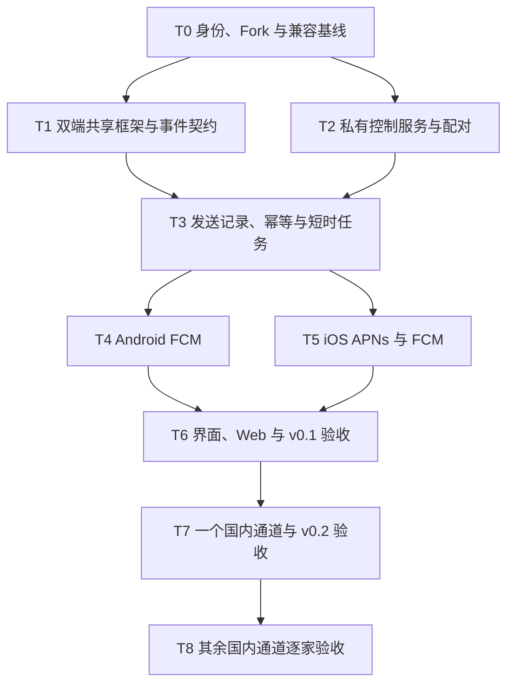

# knock-knock 开发路线与验收计划

> 日期：2026-10-23。状态：与设计配套的开发草案，未开始产品代码实施；本文件不包含产品代码或测试实现。
> 执行前阅读 [项目开发设计](../specs/2026-10-23-knock-knock-design.md)。目标和接口以该设计为依据，设计修订后同步调整本计划。

**目标：**从 FCM-toolbox 派生出 KMP/CMP 推送工具箱 knock-knock，使 Android、iOS 能测试工具箱自身的推送通道，并准确展示可获得的发送、回调与点击证据。

**架构：**保留 `app/` Android 宿主，新增 `shared/` 和 `iosApp/`；抽取 FCM 发送逻辑到独立 Node 工具服务，配套 SQLite 和轻量 Web 控制台。DooPush 只提供适配参考，不引入整套平台。

**范围约束：**只测试自身安装实例；不接业务 App token、不创建外部 SDK、不做跨通道自动兜底。本轮授权范围为真实 Fork、两份开发文档的提交与发布；不因本计划中的任务而自动实施产品代码、安装依赖或发通知。

## 1. 开发门槛和依赖顺序

同一阶段内，Android、iOS 和服务端可以在接口契约冻结后并行；不得同时改同一份消息契约。每个任务先完成自身检查，再进入依赖任务。T4/T5 接入时只发送到已配对且由操作员控制的工具箱安装实例。

本计划不预设固定工期。平台审核、账号资格、签名和可用真机先准备；不能以代码完成替代对应通道验收。

## 2. 文件与职责清单

下列是实施时的目标路径；上游已有目录随 Fork 保留，新增模块及改造尚未实施。类型/文件名可在编码前按已确认工具链作机械调整，但职责、协议字段和验收不变量不得无记录变更。

| 目标路径 | 来源或职责 |
|---|---|
| `app/build.gradle.kts`、`app/src/main/AndroidManifest.xml` | 现有 Android 入口，接 shared、新应用身份与 SDK |
| `app/src/main/.../push/` | Android FCM 及各厂商 Service/Receiver、权限、通知点击桥接 |
| `shared/build.gradle.kts` | KMP Android/iOS target、CMP、网络、序列化和存储依赖 |
| `shared/src/commonMain/.../model/` | Installation、Endpoint、TestRun、SendAttempt、Observation、通道能力 |
| `shared/src/commonMain/.../data/` | HTTP 契约、事务存储、待上报事件、历史查询 |
| `shared/src/commonMain/.../feature/` | 通道、测试、记录、设置四个 CMP 页面及状态 |
| `shared/src/androidMain/`、`shared/src/iosMain/` | 平台存储、安全凭据、系统设置及宿主入口 |
| `iosApp/` | Xcode、Swift AppDelegate/通知中心代理、Firebase SPM、签名配置 |
| `server/src/` | HTTP API、鉴权、SQLite、幂等、延迟任务及 provider 适配 |
| `server/src/providers/` | FCM、APNs 和国内通道的独立请求构造与提交 |
| `server/test/` | 协议、权限、provider 请求、任务认领和失败恢复测试 |
| `web/` | 从 `firebase/public/` 迁入并改为 HTTP 控制面的静态界面 |
| `docs/`、CI、根构建配置 | Fork 追溯、许可证、配置说明、版本矩阵及验证入口 |

三个边界必须先定：原生适配向 shared 交付注册事件与观察事件；shared/Web 只通过工具服务执行测试；provider 适配只负责请求构造、校验和提交，不能操作 UI、隐藏重试或改变测试目标。

## 3. T0：身份、真实 Fork 与兼容基线

**输入：**用户指定 GitHub 所有者；设计已核对的上游 SHA；可用的 Apple/Firebase/厂商账号信息。

- [x] 明确 GitHub 所有者与 `knock-knock` 目标名，执行真实 Fork，记录目标仓库、父仓和实际基线 SHA：`tipsypotato/knock-knock` → `SimonMarquis/FCM-toolbox`，`master` / `f793400b65f038b408dd04a73cdb10334ed87886`。工作副本以目标仓库为 `origin`、父仓为 `upstream`。
- [ ] 检查 checkout 及用户已有变更；保留 Apache-2.0 和原版权，登记引用 DooPush 代码时的 MIT 保留要求。
- [ ] 确定归属命名空间、独立 applicationId/Bundle ID、签名和工具箱专属平台应用；不沿用上游公共 Firebase 项目或公开 debug 签名。
- [ ] 建立工具链版本矩阵：Kotlin、CMP、AGP、Gradle、JDK、Xcode、Firebase 两端 SDK、Node LTS、数据库驱动。以官方兼容组合和实际构建为依据，冻结精确版本。
- [ ] 核实所选 FCM SDK 对注册 token/FID、经典 AndroidConfig 与新模式的支持；明确 v0.1 实际使用的回调与消息模式。
- [ ] 准备服务部署地址、受信任 TLS、手机到服务连通性和 provider 出口条件；配置文件只使用占位符，真实密钥走受控存储。

**完成证据：**Fork URL/父仓关系、版本矩阵、两端目标配置、通道申请清单；任何缺少的账号/设备标明阻塞项。本任务中的兼容验证不代表真实推送已经通过。

**暂停条件：**缺少 GitHub 所有者时不创建到猜测账号；缺少 Apple 或厂商资格时保留对应任务，不伪造凭据或更换产品范围。

## 4. T1：双端框架、数据契约和本地记录

**涉及：**`app/`、`shared/`、`iosApp/`、根 Gradle 配置与版本目录。

- [ ] 建立一个共享模块并让 Android/iOS 显示同一个 CMP 页面；Android 应用入口仍留在独立 `app/`。
- [ ] 定义设计第 6 节的数据字段、标识类型、事件来源、provider/transport 区别和协议版本，给客户端/服务端共用的契约夹具。
- [ ] 建立事务本地库和待上报事件记录；初始化不依赖 UI 已存在，崩溃恢复后未上报事件仍可读取。
- [ ] 原生桥接只传稳定基础字段和可序列化载荷，不向 commonMain 暴露 Context、RemoteMessage、UNNotification、NSData 等平台对象。
- [ ] 原 Android 模型中纯逻辑可以提取；重写依赖 Android UI/资源/Intent 的 Payload 结构，不用空壳 expect/actual 隐藏平台耦合。

**必要验证：**双端编译；eventId 重复写入只保存一次；点击早于受理响应仍能归并；无 testId 事件保留未关联；进程重启后历史和待上报事件仍在；展示层不把 token 存在推断为连接正常。

**验收对应：**AC-01、AC-06。输出协议夹具供 T2–T5 消费。

## 5. T2：私有工具服务、配对与目标边界

**涉及：**`server/src/`、`server/test/`、shared HTTP 客户端、Web 管理入口。

- [ ] 抽离 Firebase Functions 运行时包装，建立单 Node HTTP 服务和 SQLite 迁移；任何 provider 缺配置均不能阻止控制服务启动。
- [ ] 实现单管理员会话、5 分钟单次配对码、每安装独立凭据与撤销；设备只能注册、读取和测试自身 endpoint。
- [ ] 实现设计第 7 节注册、设备目录、capabilities、自助解绑及管理员撤销接口；声明实际已启用、未配置、不支持或未验证的通道。
- [ ] 验证 endpoint 对应配置 profile、provider、环境与允许的标识类型；发送 API 不接受外部 token/topic 和任意 appId/URL。配对仍信任受控工具箱上报，不宣称能单凭 opaque token 证明物理安装归属。
- [ ] 实现服务端限流、请求大小校验、权限校验、Web 会话来源检查、凭据脱敏，删除旧公开规则作为运行入口。

**必要验证：**过期配对、重复兑换、撤销凭据、跨安装访问、不匹配 profile 的应用/环境、NaN/负数/超大整数、未知字段和保留 key 均按契约处理；FCM 未配置时配对和历史查询可用；客户端或 Web 构建产物中没有服务端 Secret；解绑和重新配对不混用旧身份及事件队列。

**验收对应：**AC-04、AC-08、AC-10。T3 前必须完成安全边界，不能先暴露一个无鉴权发包端点再补权限。

## 6. T3：显式发包、幂等、短时延迟与证据记录

**涉及：**server 的测试接口、SQLite 任务、provider 接口、shared 测试状态与记录。

- [ ] 定义 provider 的能力、输入校验、最终请求构造、提交与结果映射；预览和发送共用构造器。
- [ ] 提供无副作用 preview、按安装授权的分页测试列表与详情，手机可发现 Web 发起的测试；服务端列表同步不得生成本机接收事件。
- [ ] 实现 TestRun 与 SendAttempt，按 endpoint 版本固定目标；一次测试只选择一个 provider。
- [ ] Endpoint 版本由服务端维护，重复标识上报不增版；冲突后重新读取 SDK 当前标识，不重放旧值；注册 generation 及串行上报防止过期结果覆盖新值，旧失效响应不影响新版本。
- [ ] 同一幂等键和内容返回同一 testId，不同内容返回冲突；网络重试和连续点击不会创建第二次提交。
- [ ] 实现 1–300 秒单次延迟、未认领任务取消、事务认领和重启恢复；手机无需后台运行才能触发发送。
- [ ] 明确“受理”“拒绝”“不确定”分支；禁止超时自动重发或跨通道兜底，未查明的提交中任务恢复为不确定。
- [ ] observation 逐项幂等补传；30 秒观察窗口只用于展示，迟到结果仍补入原测试。

**必要验证：**两并发 worker 只认领一次；provider 受理后响应丢失不重发；提交中崩溃不重复；重启时错过计划时间的未认领任务标过期而不补发；重复注册不误取消任务，轮转后不向旧/新标识静默改投；取消与提交竞争结果可解释；重复/乱序补传不增加次数；跨安装或不匹配的关联 ID 被拒绝，合法旧版本迟到事件仍保留。

**验收对应：**AC-03、AC-05、AC-06。此时用 provider 测试替身验证协议，不把替身结果算真实投递证据。

## 7. T4：Android FCM 完整接入

**涉及：**原 `FcmService.kt`、通知工具、Manifest、Android 适配、FCM server provider。

- [ ] 使用新 Firebase Android App 完成注册和更新；区分本机未支持、未配置、注册中、成功、失败与通知权限。
- [ ] 复用上游 Firebase Admin 发送核心，修复输入/TTL 校验和日志输出；新增标准 notification/data 模式，不能将上游 data-only 当作已有能力。
- [ ] 接收和点击入口先落本地事件，再进入上报队列；冷启动/无 Activity 时同样可记录。
- [ ] 按设计第 5 节冻结两种模式：标准通知包含通知内容与关联 data，data-only 只包含数据。前台均只记录，不创建本地通知；后台标准通知遵循 SDK/系统行为。
- [ ] 点击工具箱通知进入该 testId 详情；删除自动写剪贴板、启动任意外部 App/URL 等旧动作路径。

**必要验证：**载荷构造、回调解析和 Intent 关联测试；Android 编译及相关单测。设备阶段分别核对标准通知、data-only、权限关闭、前后台、锁屏和进程状态；同一次通知不因重复回调产生双重展示。

**完成证据：**所用 SDK/Android/GMS 环境、请求、provider 响应、真实回调/点击与截图/日志关联。没有回调的后台通知必须显示未观测，不补造接收时间。

**验收对应：**AC-02、AC-03、AC-07。

## 8. T5：iOS 直接 APNs 与 FCM 接入

**涉及：**`iosApp/` Swift 宿主、SPM、entitlements、shared iOS 桥接、APNs/FCM server providers。

- [ ] 配置工具箱 Bundle ID、Push Notifications、必要的 background mode 和签名；SPM 接入官方 FirebaseMessaging。
- [ ] 注册 APNs，保存正确的环境和 token；明确 Firebase delegate/swizzling 策略，维护 FCM 与 APNs 映射，避免双重转发。
- [ ] 实现直接 APNs 和 FCM-to-APNs 两种发送入口；记录 provider 不同但 transport 同为 APNs。
- [ ] 前台通知、后台静默、通知点击分别输入 shared；后台任务在系统给定预算内完成持久化并及时回调系统，不等待无限网络请求。
- [ ] 明确 alert/background 请求映射：前台 alert 只记录，不请求 banner/sound；静默采用正确的 push type、priority 和 content-available，不混入可见提醒字段。
- [ ] 通知点击/冷启动能还原 testId；从服务端取回测试详情时不得追加虚构的本机接收事件。
- [ ] APNs 凭据、环境、topic 和 token 错误返回准确诊断；服务端不把 sandbox 失败自动切到 production。

**必要验证：**Swift/shared 入口编译、回调与载荷映射、环境错误、FCM/APNs 标识混用拒绝。真机分别核对前台、后台 alert、静默、锁屏和用户强退；记录哪些事件未被系统提供。

**完成证据：**签名 entitlement、脱敏应用身份、两个 provider 的发送响应、工具箱真实回调/点击。仅模拟器 UI 运行或注入通知不算通过。

**验收对应：**AC-02、AC-05、AC-06、AC-07。NSE 不混入本任务，不把静默消息当稳定心跳。

## 9. T6：CMP 四页、轻量 Web 与 v0.1 交付

**涉及：**shared feature 页面、Web 静态资源、README、发布/隐私说明与 CI。

- [ ] 完成通道、测试、记录、设置四页；复用 T1–T5 状态，不在 UI 中另写第二套推送逻辑。
- [ ] 将 `firebase/public/` 迁入 `web/`，替换 callable/RTDB；选择已配对工具箱设备，显示发送请求、响应、事件和取消结果。
- [ ] 新服务同源提供 Web，所有启动资源本地交付；不要求 Google CDN、Firebase Auth/RTDB 连通才能打开控制台。
- [ ] 更新品牌、隐私说明、图标/PWA/service-worker 缓存、assetlinks/CI 等引用；保留开源来源和许可证。
- [ ] 完成前台/恢复时分页发现测试和观察窗口内详情轮询，后台停止轮询；测试条件与观测状态分开呈现。
- [ ] 完成默认脱敏导出、7 天数据保留和本地收件清空；清空前展示未上传数量，服务端副本不删除、不重建本地收件，旧上传回包不恢复已删事件；键盘、读屏标签、动态字体和颜色状态的文字说明不能遗漏。
- [ ] 独立复查请求、页面用词、配置和测试记录，确认没有将受理、回调、展示混写为单一“成功”。

**完成门槛：**AC-01 至 AC-07、AC-10 的 v0.1 范围通过；AC-08 做控制面独立性检查，国内真实投递留待 T7；AC-09 标清暂未接入厂商。交付 Android/iOS 包、部署说明、版本矩阵、已知限制与证据索引，不仅是源码能编译。

## 10. T7/T8：国内通道逐家扩展

**先完成 T7：**选择实际具备材料和真机的一家厂商，优先华为 HMS；若账号/设备不具备则明确更换验证顺序，不改变全量目标。

每家厂商均执行同一份独立交付清单：

- [ ] 为 knock-knock 自身申请/核实包名、签名、应用身份、地区、通知类型及必要的 channel/template 权益。
- [ ] 冻结官方 SDK 及支持 ROM/设备；核实可提供的注册、接收、点击或服务端回执，不从其他厂商类推。
- [ ] Android 原生适配实现注册与回调；服务端实现本 provider 校验和请求；commonMain 只增加能力和对应表单字段。
- [ ] 该 provider 单独启用/失败，不能导致其他通道初始化失败；未支持设备显示原因，不用品牌判断冒充可用性。
- [ ] 在禁止 Google/Firebase 控制面访问的网络条件下，验证配对、当前国内 provider 测试和事件查询仍可完成。
- [ ] 分别核对通知/透传权限、额度/模板错误、注册更新、前后台和点击；保存实际请求和证据，不用空回调通过测试。

T8 按荣耀、小米、OPPO、vivo、魅族等实际材料顺序重复。厂商专属参数和接入限制写入能力表，不悄悄在统一字段中丢失。新通道完成后，回归 Android FCM 和 iOS 两条发送入口；有条件时才扩大完整设备矩阵。

**完成门槛：**每个宣称支持的通道满足 AC-03 至 AC-10 中适用条目。只实现适配但未取得审批或未上真机的通道必须标“未验收”；不能据此声明 v1.0 已完成全覆盖。

## 11. 验证层次与证据要求

| 层次 | 验证内容 | 不能替代的内容 |
|---|---|---|
| 文档检查 | 路径、引用、目标边界、阶段依赖、接口/术语一致性 | 任何代码或运行验证 |
| 共享/服务单测 | 状态、JSON/大小、权限、幂等、token 轮转、任务中断、迟到事件 | 平台 SDK 和实际网络投递 |
| 原生桥接测试 | 回调转换、Intent/delegate、环境映射和启动路径 | 系统真实后台行为 |
| 双端构建 | Android debug/release、iOS simulator/device 目标链接，签名配置检查 | 推送是否真实到达和展示 |
| provider 契约测试 | 请求头、载荷、错误码和凭据边界；使用脱敏夹具 | 真实账号权限与厂商受理 |
| 真机验收 | 自身工具箱各通道、前后台/锁屏/进程状态、权限与网络差异 | 其他业务 App 的推送质量 |

实施时在工程中提供并记录真实可运行的最小验证命令；具体 Gradle task、Xcode scheme 和 npm scripts 在工具链/目录落定后登记，文档阶段不编造不存在的命令或通过记录。

设备验收证据至少包含：构建版本、设备/OS/SDK、通道及消息模式、测试编号、操作前状态、发送与 provider 响应、实际回调/点击、未观测阶段及原因。固定时间等待只定义观察窗口，不构成必达 SLA。

后台、锁屏、系统回收、用户强退/force-stop 的前置条件由操作员记录并以截图/操作轨迹佐证，使用网页发送或服务端延迟任务触发；无需给产品新增系统监控器。Observation 中的 App 状态只说明回调当时状态，点击导致的前台状态不能倒推消息发送时状态。没有回调时仍保留人工前置条件与服务端证据，结论为未观测。

**设备操作授权边界：**本计划只规划未来设备测试，不授权本轮运行。后续只有用户明确要求设备测试或 UI 自动化时，才在请求范围内使用 ARTEMIS；普通代码、编译、单测不得触发设备探测、模拟器启动或 ARTEMIS 调用。iOS 设备验证使用适用工具，不能以 Android 自动化代替。

## 12. 发布、回滚与交接

- 每个阶段结束前复查差异，避免混入无关模块、业务工程或上游依赖升级。需要保留新依赖时记录用途，不引入运营平台或第二套 ORM。
- 原上游公开设备/消息数据不迁移，工具箱使用独立身份。后续版本的本地/服务端 schema 变化采用版本化迁移；数据库升级前备份，回滚旧二进制前确认 schema 兼容，不直接删除用户测试记录。
- provider 可以单独停止发送；撤销一个设备不会影响其他设备。已发出的远程通知不能通过回滚撤回，界面不得误导。
- 本轮用户已授权提交和发布两份开发文档；未创建 PR 或部署，后续代码任务不自动执行。文档提交信息：`docs: define knock-knock multiplatform push toolbox`。

### 12.1 当前交接状态

| 项目 | 状态 |
|---|---|
| 产品目标与只测试自身边界 | 用户已确认 |
| 上游结构、许可证与关键风险 | 已静态核对，快照见设计文档 |
| 推荐架构及分期 | 已形成草案，未标记为用户批准 |
| GitHub Fork | 已创建 [tipsypotato/knock-knock](https://github.com/tipsypotato/knock-knock)，父仓 `SimonMarquis/FCM-toolbox`；实际基线 `f793400b65f038b408dd04a73cdb10334ed87886` |
| 项目源码、依赖、平台配置 | 保留 Fork 上游内容，本轮未修改；KMP/CMP 改造尚未实施 |
| 编译、真机、服务部署与推送发送 | 未执行 |

进入编码前应评审推荐架构与首版范围；本计划不自动推进到实施。未落实的外部条件保留在任务上，不能通过省略验证把它们改为完成。
