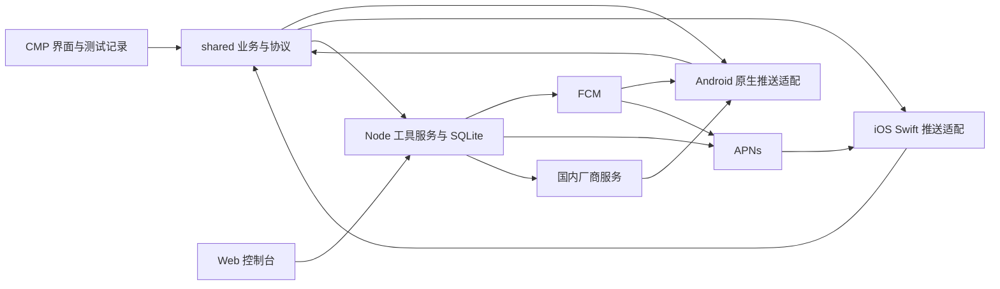

# knock-knock 项目开发设计

> 日期：2026-10-23，Asia/Shanghai。状态：设计草案，供开发前评审；未进入代码实施。
> 已确认：从 FCM-toolbox 派生，采用 Kotlin Multiplatform（KMP）与 Compose Multiplatform（CMP），覆盖 Android、iOS；只测试工具箱自身的各通道收发。
> 本轮交付范围为真实 Fork 与开发文档，产品代码未修改。下文新增模块、接口、配置和里程碑均为拟议设计，不代表已经创建或验证。

## 1. 项目定位与成功标准

knock-knock 是面向移动开发者的推送测试工具箱。开发者安装工具箱，注册适用于当前设备的推送通道，选择一条通道发送测试消息，然后查看发送结果、客户端可观察到的回调、通知点击和测试历史。

工具回答四个问题：通道能否注册；发送服务是否成功提交；系统或 SDK 给了什么回调；用户点击后工具箱收到什么数据。不能获得的证据必须明确标为“未观测”，不能推断为失败或成功。

### 1.1 已确认的产品边界

- 产品名与目标仓库名：`knock-knock`。
- Android 与 iOS 均提供 CMP 界面和真实推送收发能力，不能仅把 Android 页面移植后把 iOS 留成占位页。
- 接收对象仅为 knock-knock 自身的安装实例。手机端默认且仅对本机发起测试；浏览器可选择已配对的工具箱设备。
- 不提供第三方业务 App token 输入，不开发给业务 App 接入的诊断 SDK，不抓取其他 App 通知。
- 延续 FCM-toolbox 的客户端与网页协作方式，参考 DooPush 的厂商适配和结果展示，不整体引入 DooPush 平台。

### 1.2 完整产品目标与首版范围

| 阶段 | Android | iOS | 配套能力 |
|---|---|---|---|
| v0.1：双端闭环 | FCM | FCM 经 APNs、直接 APNs | 配对、通道状态、立即/短时延迟测试、历史、回调、点击、脱敏导出、最小网页控制台 |
| v0.2：国内通道验证 | 完成一个具备账号和设备的国内通道，默认优先华为 HMS | 保持 v0.1 能力 | 验证无 Firebase 控制面依赖、显式选路、厂商错误与参数映射 |
| v1.0：目标通道覆盖 | FCM、华为、荣耀、小米、OPPO、vivo、魅族逐家接入验收 | 保持 FCM/APNs 双入口 | 每条通道独立能力说明、配置检查、真实设备证据 |

以上分期是本设计建议。厂商账号、应用审核、SDK 与设备资格是实际交付依赖；缺少条件的通道标记“未开通/未验证”，不能用空适配器计为完成，也不能宣称 v0.1 已覆盖国内全厂商。

### 1.3 不做的内容

不做营销群发、用户画像、标签运营、定期任务、商业多租户、跨通道自动兜底、必达承诺、桌面客户端、CMP Web、HarmonyOS NEXT 原生应用、VoIP PushKit、通知监听器或系统推送协议逆向。iOS Notification Service Extension（NSE）不纳入 v0.1；只有明确需要其限定范围的后台通知观察时再单独设计。

## 2. 上游与现有资料核对

### 2.1 参考快照

| 项目 | 核对快照 | 许可证 | 用途 |
|---|---|---|---|
| [FCM-toolbox](https://github.com/SimonMarquis/FCM-toolbox/tree/f793400b65f038b408dd04a73cdb10334ed87886) | master，`f793400b65f038b408dd04a73cdb10334ed87886` | Apache-2.0 | Fork 基线、FCM 发包、Android 回调与消息记录、网页交互 |
| [DooPush](https://github.com/doopush/doopush/tree/2b8880a205bf5fd2eef73dd1ce20aa0da5ccede4) | main，`2b8880a205bf5fd2eef73dd1ce20aa0da5ccede4` | MIT | 多厂商服务端适配、Android SDK 回调、设备与投递结果模型 |

已读取工作区现有厂商接入和推送迁移调研的相关部分，复用其“应用身份独立、token 类型不可混用、受理与送达分开”等约束。本项目是独立工具，不依赖 York、mPaaS、CIF2 或业务消息服务。已创建个人 Fork；本轮仅增加开发文档，未实施产品改造。

### 2.2 FCM-toolbox 的实际结构和迁移影响

| 当前路径/能力 | 核对结果 | knock-knock 处理 |
|---|---|---|
| `app/` | Android AppCompat、XML/ViewBinding、LiveData；不是 Compose 工程 | 保留目录作为 Android 宿主，界面逐步重写为 CMP |
| `services/FcmService.kt`、`utils/Notifications.kt` | Android FCM 回调和通知处理 | 保留平台职责，接入共享事件记录；不直接迁进 commonMain |
| `data/model/`、`data/db/`、`data/repository/` | 消息、载荷、token、presence；Android Room/Moshi 等依赖 | 复用概念及可复用的纯 Kotlin 逻辑；共享存储与序列化重新适配 |
| `viewmodel/PresenceLiveData.kt` | Firebase Realtime Database presence | 改为工具服务的注册及最近联系时间；不视作推送连接状态 |
| `firebase/functions/index.js` | Cloud Functions callable 包装 Firebase Admin SDK 发包 | 抽取 FCM 核心逻辑到独立 Node.js 服务；替换 Firebase callable 协议 |
| `firebase/public/` | 真正的 Web 控制台，包括 JS、CSS、PWA 文件和 assetlinks | 迁至 `web/`，保留可复用页面和样式，改接新 HTTP API |
| `docs/index.html` | 项目文档页面 | 不误作 Web 应用入口；文档与产品静态资源分开 |

源码快照中的 `devices` 数据规则允许公开读写；发送函数体未校验 `request.auth`、未启用 App Check 强制检查，并记录完整请求/消息。它是公开演示的边界，不能照搬为本项目的默认部署。原 `to` 可接任意 token/topic，也应删除。原 TTL 的 `parseInt` 路径需要补有限整数与范围校验，不能仅复制代码。[S1][S2]

当前 Functions 清单仍声明 Node 18；该值不是新项目的运行时推荐。新服务采用实施时仍受支持且满足 Firebase Admin SDK 要求的 Node LTS，冻结精确版本与 lockfile。[S3]

上游实际发送的是 **data-only**，Android 收到后自行创建本地通知；不是已经实现标准 notification/data 混合消息测试。新工具的“系统通知”和“数据消息”必须分开：标准通知测试由 provider/系统负责可见通知，数据消息默认只记录回调、不自动补本地通知。否则无法判断到底是谁展示的通知。新增标准通知模式及 iOS 模式都属于后续开发工作。[S1]

DooPush 只作参考：不搬入其 Go、MySQL、Redis、运营后台和长连接网关。文档快照明确其目标筛选存在仅选离线设备的行为，在线消息路径和部分厂商分析未完成；knock-knock 无论 App 是否在线都必须按用户选择调用厂商通道。[S4]

## 3. 技术方案与取舍

| 方案 | 收益 | 代价/限制 | 决策 |
|---|---|---|---|
| KMP/CMP 客户端 + 原 Firebase 控制面 | 上游改动较少 | 国内测试控制面依赖 Firebase 网络，公开演示边界需要重做 | 不作为默认方案 |
| KMP/CMP 客户端 + 单 Node.js 工具服务 | 复用上游 JS/FCM 核心；可在局域网或自有服务器部署；控制面不依赖 Google | 新增鉴权、持久化及 HTTP API | **推荐，待设计评审** |
| KMP/CMP 客户端 + 完整 DooPush 后端 | 可利用较多现成功能 | 运营功能和基础设施明显超出自测工具范围 | 不采用 |

推荐方案的边界：一个共享模块、两个原生宿主、一个服务进程、一份 SQLite 数据库、一套轻量网页。Firebase Admin SDK 仅作为 FCM provider 使用。未配置 FCM 或 Google 出口不可达时，其他 provider、配对、记录查询仍可工作；FCM 实际发送本身仍需要可达的 Google 鉴权及 FCM 网络。

### 3.1 目标结构

以下为改造后的目标结构；上游已有路径随 Fork 保留，本轮不创建新增源码模块。

```text
knock-knock/
  app/                    Android 应用入口、SDK、Service/Receiver、签名接入
  shared/
    src/commonMain/       CMP 界面、模型、用例、HTTP 客户端、记录与事件归并
    src/androidMain/      Android 平台实现、存储驱动与宿主桥接
    src/iosMain/          iOS 平台实现、存储驱动与 Swift 友好入口
    src/commonTest/       状态、协议、能力及数据逻辑测试
  iosApp/                 Xcode 宿主、Swift 推送代理、SPM 配置、entitlements
  server/                 Node HTTP 服务、配对、设备目录、发包、历史及任务
  web/                    从 firebase/public 迁入的最小控制台
  docs/                   项目说明、开发设计、验收、上游来源
  gradle/libs.versions.toml
```

共享 Android 库与 `app/` 应用模块分离；保留 `app/` 名称降低 Fork 路径改动。iOS 宿主消费单个 shared framework，优先采用同仓直接集成。Android/iOS SDK 类型不得泄漏到 commonMain。[S5]



### 3.2 共享与原生职责

| 层 | 负责 | 不负责 |
|---|---|---|
| commonMain | 四个页面、测试参数与能力校验、协议、状态归并、本地记录、脱敏导出、HTTP 调用 | 直接调用 Android Firebase/HMS SDK 或 Apple UserNotifications |
| Android 宿主 | 按能力注册 FCM/厂商 SDK、通知权限与 Channel、接收/点击、冷启动、SDK 版本与错误 | 决定跨厂商兜底；保存服务端发送凭据 |
| iOS Swift 宿主 | FirebaseMessaging/APNs 注册、token 映射、通知中心代理、前台/后台/点击回调、签名环境 | 把所有后台通知都报告成 App 已收到 |
| Node 服务 | 已配对设备与 endpoint、凭据解析、显式选路、最终请求、厂商响应、短时延迟任务、历史 | 以 HTTP 200 代替设备送达证明；按在线状态跳过推送 |
| Web | 选择工具箱设备、发起测试、查看结果、生成配对码 | 输入任意 App token、存储厂商私钥或替代移动客户端 |

KMP 使用 Kotlin 协程与 kotlinx.serialization；HTTP 候选为 Ktor Client；共享持久化候选为 SQLDelight。选择 SQLDelight 是为了两端回调记录和待上报事件共用事务，不叠加第二套 ORM。依赖和版本在准备阶段验证后冻结，不为复用 Android 旧依赖而增加第三方 Firebase KMP 包装层。iOS 通过 SPM 使用官方 FirebaseMessaging，薄 Swift 层向 shared 传递稳定字段。[S6]

建议系统基线为 Android API 24、iOS 15，最终取 CMP、Firebase 和各厂商 SDK 的兼容交集。Kotlin/CMP/AGP/Gradle/JDK/Xcode/SDK 精确版本本轮未做编译验证；进入实施前必须建立并验证一组版本矩阵，不把官网各自最新版本直接拼接为已验证组合。[S7]

## 4. 用户流程与界面

### 4.1 首次使用

1. 管理者部署工具服务，为 knock-knock 自身配置需要测试的 provider 与应用身份。
2. 打开 Web 管理页生成一次性配对码；手机输入服务地址和配对码。
3. 手机获得仅属于当前安装实例的访问凭据，检查通知权限，用户明确启用适用通道。
4. 展示每条通道的配置、设备支持、注册结果与权限；失败显示错误来源及可执行建议。
5. 选择通道和消息类型，发送或设置一次短时延迟；之后在记录页查看各层证据。

配对仅确认管理员信任该安装实例，不宣称能抵抗伪造客户端的强远程设备证明。v0.1 是受控自测部署，不是开放给匿名用户的公共推送服务。

### 4.2 四个移动端页面

| 页面 | 最小内容 |
|---|---|
| 通道 | 当前设备、通道能力、是否配置、注册进度、标识类型及脱敏值、最后刷新、通知权限；重新注册和系统设置入口 |
| 测试 | 当前设备与显式 provider、消息类型、标题/正文、数据 JSON、受支持的 TTL/优先级等选项、立即/延迟发送、服务端生成的请求预览 |
| 记录 | 按测试编号、通道、时间筛选；受理结果、回调、点击与证据来源；发送载荷和回调载荷分开；重测、导出 |
| 设置 | 服务地址与配对状态、构建/SDK 信息、配置健康检查、解除配对、清空本地收件记录、开源许可 |

v0.1 不需要任意深链执行器。点击工具箱通知只进入对应测试详情；data 中的 URL、命令或包名仅作为测试数据展示，不自动执行上游的打开任意 App/URL、剪贴板写入等动作。

### 4.3 支持的测试操作

- 单次通知：可见通知及点击数据检查。
- 单次数据/静默消息：仅在 provider、系统、账号权限允许时开放。
- 一次延迟发送：1–300 秒，便于操作员将工具箱切到后台或锁屏；由服务端计时，不能依赖手机后台定时器。
- 重测：复用参数，创建新的测试编号；不复用旧测试的发送身份。
- 同设备多通道对比：分别手动发起独立测试，明确它们是多次发送；不增加隐藏双发或自动回退。

每条通道不支持的字段标明原因，不静默忽略或假装成功。JSON 必须是对象，校验保留字段和 provider 的字节大小/类型限制；最终校验由服务端执行，不能只依赖 UI。

### 4.4 历史发现、清理与重新配对

移动端启动、恢复前台、进入记录页或手动刷新时，通过授权的分页列表发现测试，包含 Web 发起的测试；再按 testId 关联本地事件。当前详情页在观察窗口内每 2 秒查询一次结果，退出页面或进入后台停止轮询，之后通过手动刷新或再次前台更新。列表每页最多 50 条，不要求后台长连接。

“清空本地收件记录”只清除本机接收/点击副本及尚未上传的观察队列，执行前显示待上报数量并确认。服务端测试与已上传观察仍保留到 7 天，页面明确区分“本地收件”和“服务端测试记录”；同步服务端数据不能重新生成已清除的本地观察。已在途的上传可更新服务端，但其结果不得重建本地已删除事件。

解除配对先撤销服务端设备凭据并取消该安装未认领的任务，再清除本机访问凭据；提交中的任务不能撤回。网络不可达时保持“解绑待完成”，不谎报服务端已撤销，可由管理员独立撤销。再次配对生成新的 installationId；旧记录可只读保留但不再补传，不能用新凭据提交旧安装队列。

## 5. 通道与平台能力

| provider / 下行传输 | 平台 | 注册标识与前提 | 结果可观察范围 |
|---|---|---|---|
| FCM / Android transport | Android | 对应工具箱 Firebase App；可用 Google Play 环境与网络；注册标识模式与 SDK 版本一致 | SDK 回调、通知点击；后台自动展示受消息模式影响 |
| FCM / APNs | iOS | FCM 注册标识、APNs token、正确映射、Firebase 中的 APNs 配置 | Apple 系统/SDK 给出的前台、后台和点击回调 |
| APNs / APNs | iOS | 工具箱 Bundle ID、APNs token、实际签名 entitlement 的环境、服务端授权 | 同上；没有通用的“通知已展示”逐条回执 |
| 华为/Honor/小米/OPPO/vivo/魅族 | Android | 分别申请工具箱应用、客户端材料和服务端授权；设备/ROM/地区/账号资格满足要求 | 逐厂商记录真实注册、接收、点击或可用平台回执，不能统一承诺全部阶段 |

FCM 向 Apple 应用的消息最终都通过 APNs。两种发送入口用于测试 provider 配置与载荷映射，不能解释为两条独立的 iOS 系统推送连接。FCM 标识与 APNs token 分开存储。[S8]

v0.1 冻结为以下两种消息模式，内部关联字段始终存在：

| 入口 | 通知模式（可附带用户 data） | 数据/静默模式 | 前台与后台的固定展示策略 |
|---|---|---|---|
| Android FCM 经典模式 | `notification` 加关联及用户 `data` | 仅 `data` | 前台只记录回调，不额外创建本地通知；后台通知交由 SDK/系统，点击后记录关联；数据模式只记录实际回调 |
| iOS FCM | FCM 通知与 data，映射至 APNs alert | APNs 配置包含 `content-available=1`、background push type、priority 5，不带 alert/sound/badge | 前台 alert 代理只记录并不请求 banner/sound；后台 alert 由系统决定展示；静默只记录实际后台回调 |
| iOS APNs 直连 | `aps.alert`、alert push type 与关联数据 | 同上，直接构造 APNs background 请求 | 同 iOS FCM，二者共享相同 Apple 原生处理策略 |

测试页显示“前台仅记录，后台通知由系统处理”，防止用户把主动抑制的前台横幅当作丢失。v0.1 不增加 App 主动创建本地通知的第三种模式。系统后台通知的展示不是客户端可保证或全量观察的事件。

### 5.1 Android 约束

- 消息接收由 Service/Receiver 进入，不依赖 Activity 或 Compose 已启动；先持久化事件，再尝试上报。
- 通知权限和推送注册分开：拥有 token 不代表通知允许展示，也不代表当前连接正常。
- 原 FCM-toolbox 使用经典 HTTP v1/AndroidConfig 思路。当前 Firebase 文档已引入 AndroidConfigV2 和新的接收能力；准备阶段核实实际 SDK，v0.1 默认保持上游已可复用的经典模式。如所选 SDK 不再支持，先修订模式与验收矩阵，不能无声切换。[S9]
- 经典后台 notification 可能由系统/SDK直接展示；收到点击 Intent 才观察到 data 时，记录“点击时观察”，不补造更早的接收时间。
- 国内通道依据 SDK 能力和真实注册判断是否可用，不只按品牌字符串；例如不同荣耀系统不得统一推断为同一通道。
- App 被系统回收、划掉最近任务、用户执行 force-stop 是不同测试条件；不得合并为“杀进程”。

### 5.2 iOS 约束

- APNs 注册、权限和 token 更新由原生宿主处理。FCM 的 APNs 映射策略只采用一种，明确代理/swizzling 与手动转发的职责，避免重复上报。[S8]
- APNs 的 sandbox/production 依据签名 entitlement 与 provisioning 结果确定，不能用 Debug/Release 名称猜测；token、topic、环境必须匹配。[S10]
- 后台 alert 可以显示但没有 App 接收回调；静默推送可能被节流、合并或丢弃。用户强退后的行为单列，不能承诺唤醒。[S11]
- App 恢复后可补上传已本地保存的回调；不能把从服务端同步到的发送记录冒充本机接收记录。
- v0.1 不用 NSE 制造“全量收件日志”。将来如加入 NSE，只记录其实际执行事件，仍不能把扩展被调用解释为用户看到通知。[S12]
- 模拟器用于构建、UI 和合成回调；模拟注入通知不计为真实 FCM/APNs 投递验收。

## 6. 数据契约与证据语义

### 6.1 核心记录

| 记录 | 最小字段/规则 |
|---|---|
| Installation | 服务端 `installationId`、平台、工具箱应用标识、构建/OS 版本、配对状态、最近联系时间；不采集 IMEI/硬件序列号 |
| Endpoint | `endpointId`、installation、provider、`identifierType`、标识值、版本号、应用身份、环境、注册时间、状态；标识值不作为主键 |
| TestRun | `testId`、幂等键、endpoint 与版本快照、provider、消息类型、请求参数摘要、计划时间、创建时间、观察窗口 |
| SendAttempt | `attemptId`、testId、最终发送时间、脱敏请求快照、厂商消息 ID（若存在）、HTTP/厂商状态、受理/拒绝/不确定 |
| Observation | `eventId`、testId、attemptId（可得时）、endpoint、来源、事件类型、设备事件时间、服务端接收时间、App 状态快照、回调载荷 |

`identifierType` 明确区分 FCM registration token、SDK 支持时的 FID、APNs token 和厂商标识；每个 provider 接受的类型由已冻结适配定义，不能把任意 FID 当作 token 发出。v0.1 不为了支持未来类型强行做双栈注册。

内部关联字段使用保留命名空间，例如 `kk_test_id`、`kk_attempt_id` 和协议版本。服务端负责写入并按 provider 编码，用户 data 不得覆盖；点击/接收适配器需要从各自载荷恢复关联。没有关联 ID 的事件仍保留为“未关联观察”，不猜配给最近一条测试。

Endpoint 以 installation/provider/profile 为稳定身份，版本由服务端分配；只有标识、应用身份或环境实际变化才增版，相同值重复上报不增版。更新携带已知服务端版本，版本冲突返回 409；客户端重新查询并读取 SDK 当前标识后再提交，不重放陈旧值。原生注册有递增 generation，过期注册任务的回调不得覆盖新一轮注册；上报队列按 provider 串行并合并尚未发出的旧值。厂商失效响应仅能使 SendAttempt 引用的 endpoint 版本失效，不能失效已轮转的新版本。

Observation 的 testId、attemptId、endpoint 必须相互匹配且归属当前配对安装；不存在关联时可保存为未关联事件，伪造或跨安装关联必须拒绝。合法的旧 endpoint 版本迟到事件仍归属原测试，不因 token 轮转而删除。App 状态快照仅表示回调发生时状态，不代表推送发送或系统展示时状态。

### 6.2 状态不可合并

| 状态/事件 | 准确定义 |
|---|---|
| 已排队 / 已取消 | 工具服务中的一次性任务状态，尚不能说明 provider 已收到 |
| 提交中 | 已认领发送任务，provider 结果未确定 |
| 厂商已受理 | provider 返回成功；不代表手机已接收 |
| 厂商拒绝 | provider 明确拒绝，保留原始错误码及可理解说明 |
| 提交结果不确定 | 超时或崩溃造成是否受理未知；不自动再次发包 |
| App/扩展回调 | 确实执行了对应 SDK/系统入口，记录入口和来源 |
| 用户点击 | 系统向工具箱分发了点击事件 |
| 厂商送达回执 | 仅在 provider 支持且通过来源验证时记录；v0.1 不强制接入所有厂商回执 |
| 未观测 | 观察窗口内没有相应证据；不是“丢失”或“未展示”的结论 |

事件追加保存，展示层做稳定归并；重复事件按 eventId 去重，乱序与迟到事件仍可补充证据。App 回调、点击和 provider 状态是独立维度，不用一个单调枚举覆盖它们。

默认观察窗口为实际开始发送后 30 秒，计划等待时间不计入；到期仅显示“窗口内未观测”。后来到达的事件仍关联原测试。服务端可显示自己的排队/受理耗时；客户端和服务端墙钟差值仅标记估计，不能作为准确单向推送延迟。

### 6.3 持久化与失败处理

- 客户端本地库保存接收/点击事件及待上报队列；UI 未启动也能写入；网络恢复或下次前台再补传。
- 服务端 SQLite 保存配对、endpoint、TestRun、SendAttempt、事件和短时任务；使用事务保证同一幂等键只认领一次。
- 同一幂等键、同一请求返回原 testId；同键不同内容返回 409；客户端网络重试不得变成再次推送。
- 发送前固定 endpoint 版本。执行时已轮转或失效则明确结束为“目标已变化”，要求重测，不向旧标识或新标识悄悄改投。
- 服务重启后，未认领且计划时间仍在未来的任务继续等待；已经错过计划时间的未认领任务标为“已过期”，不补发。曾进入提交中但结果未落库的任务转为“不确定”，不得盲目重发。计划过期与发送后的 30 秒观察窗口是不同概念。
- 默认不自动重试 provider 发包，不自动换通道；报告明确失败后由用户发起新的测试。回调补传可以安全重试。
- 默认保留 7 天测试数据，支持本地收件清空与导出；服务端不增加单独的手动批量清空入口。未上报事件保留到同一上限，过期清理须记录丢弃数量，不静默谎报已同步。

## 7. 控制面与发送服务

### 7.1 最小接口（拟议 v1）

| 接口 | 权限与作用 |
|---|---|
| 管理登录、退出 | 单部署单管理员；会话仅用于本工具控制台，不建设用户系统 |
| `POST /api/v1/pairing-codes` | 管理员创建单次、5 分钟有效的高熵配对码 |
| `POST /api/v1/pairings` | 兑换配对码，返回安装身份与专用设备凭据；过期/重复兑换拒绝 |
| `PUT /api/v1/installations/self/endpoints/{provider}` | 设备上报合法类型的注册结果，携带已知版本供并发校验，服务端分配新版本；不能修改别的安装 |
| `GET /api/v1/installations` | 管理员读取已配对工具箱设备；设备只能读自身信息 |
| `DELETE /api/v1/pairings/self` | 撤销当前安装凭据，取消未认领任务，返回成功后清理本机凭据；重复撤销不得触发新动作 |
| `DELETE /api/v1/installations/{id}` | 管理员逻辑撤销设备与未认领任务，历史仍按保留策略存在，不代表删除已发出的通知 |
| `POST /api/v1/tests/preview` | 与发送相同的目标权限及构造校验，只返回脱敏最终请求，不创建任务、不调用 provider |
| `POST /api/v1/tests` | 手机仅能指定自身 endpoint；管理员可选已配对工具箱 endpoint；必须携带幂等键 |
| `GET /api/v1/tests` | 按安装归属过滤，按创建时间与 testId 稳定倒序分页，游标包含排序边界；支持通道/时间过滤，每页至多 50 条 |
| `GET /api/v1/tests/{id}` | 返回该测试参数、最终请求摘要、受理结果、事件和观察状态；按归属授权 |
| `POST /api/v1/tests/{id}/cancel` | 仅允许取消尚未认领的延迟任务；认领后返回冲突，不伪称撤回厂商通知 |
| `POST /api/v1/observations` | 设备批量补传自身观察，逐项返回 accepted/duplicate/rejected，eventId 幂等 |
| `GET /api/v1/capabilities` | 返回部署已启用 provider、应用身份摘要、已核实参数范围与缺少的前提，不返回凭据 |

预览与真正发送必须使用同一 provider 构造器，预览不发包。先定义统一的少量字段，再保留 provider 专属的受控字段；不能把所有厂商参数压成一个丢失含义的大字符串。HTTP 接口统一校验对象类型、大小、枚举、整数范围、时间和目标权限。

### 7.2 网络、权限和密钥

- 默认私有部署，单管理员；设备配对授予自身 endpoint 的注册/测试/上报权，可由管理员撤销。凭据与 provider token 是不同类型。
- 设备凭据使用至少 256 位随机值，服务端保存其哈希，手机使用 Keychain/Android 安全存储；配对码至少 128 位随机值，一次兑换后立即失效。
- Web 使用 Secure、HttpOnly、SameSite 会话；同源部署并校验敏感操作来源，必要的 CSRF 防护不能省略；不把管理员凭据写入 URL 或 localStorage。
- 配对兑换和发送接口均有限流；发送默认每安装每分钟最多 10 次，另受厂商实际额度约束。限制在服务端执行，重复幂等请求不重复消耗发送次数。
- 服务端 provider profile 固定绑定 knock-knock 的应用身份、环境和凭据；调用者不能提交任意服务端 URL、App ID、topic 或外部 token。
- 上一条约束针对发送 API：注册 API 仍需接收原生 SDK 取得的 opaque 标识。服务端能检查 profile、类型、格式和授权归属，不能仅靠标识独立证明它属于该物理安装或证明客户端签名环境。v0.1 信任管理员配对的受控工具箱，禁止 UI/发送接口导入外部目标；不把这一边界宣称为对恶意已配对客户端的设备证明。
- Firebase Service Account、APNs `.p8`、厂商发送 Secret 只从服务端受控配置加载，不进入 App、Web 包、源码或导出。按 SDK 要求存在于客户端的配置项不得与服务端发送密钥混为一谈。
- TLS 使用受信任证书；局域网开发也不引入 trust-all/全局 ATS 关闭。服务端与手机的可达性单列，Google 出口错误只归属 FCM 能力。
- 诊断页默认脱敏标识，可由用户主动查看/复制本机注册标识；导出默认移除完整标识、鉴权字段和私密配置。测试正文是否导出由当次导出选择，不把任意正文写入普通服务日志。

## 8. Fork、迁移与发布约束

1. 已按用户要求在个人账号 `tipsypotato` 下创建真实 Fork：[tipsypotato/knock-knock](https://github.com/tipsypotato/knock-knock)，父仓为 [SimonMarquis/FCM-toolbox](https://github.com/SimonMarquis/FCM-toolbox)，保留上游历史与 Apache-2.0 许可证。工作副本以目标仓库为 `origin`、父仓为 `upstream`。
2. 实际分叉基线为 `master` 的 `f793400b65f038b408dd04a73cdb10334ed87886`，与本设计调研快照一致。默认从记录基线开始，不把上游日常依赖更新混入架构迁移。
3. 使用独立 Android applicationId、iOS Bundle ID、Firebase 项目和厂商应用；其前缀由仓库所有者的命名空间确定。本设计不虚构可用的包名或平台账号。
4. 保留 Apache-2.0 原许可证、版权及适用 NOTICE；如复制 DooPush 代码，保留对应 MIT 声明并记录来源文件/commit。仅参考设计与实际复制代码分别登记。
5. 原上游配置、公共 Firebase 实例、旧包名、图标/PWA 名称、service worker 缓存名和 assetlinks 全部进入迁移检查。原公共数据库和设备记录不迁移，新工具不能意外向上游设备发消息。
6. Android `app/` 逐步切换到 shared；旧 View 界面仅在对应 CMP 页面验收后移除。迁移中保留可恢复 Git 节点，不覆盖已有未提交工作。
7. 原 `firebase/functions` 和 RTDB 路径在新服务完成验收后退出本项目部署；未迁移旧网页不得暴露为可工作的默认入口。新 Web 不加载 Firebase Auth/RTDB 或依赖 Google CDN 才能启动。
8. v0.1 采用开发签名/受控分发；App Store/各厂商商店上架作为按接入资格需要推进的工作，不以本设计文档代表已经满足上架条件。

## 9. 验收不变量

| 编号 | 可验收要求 |
|---|---|
| AC-01 | Android、iOS 均可启动 CMP 四页；共同状态与历史行为一致，平台差异明确可见 |
| AC-02 | Android FCM、iOS FCM、iOS 直接 APNs 各完成真实发包、可观察回调/点击和关联记录；无证据的阶段显示未观测 |
| AC-03 | 用户指定的 provider 是唯一提交目标，前台/在线不跳过，失败不自动改投 |
| AC-04 | 未配对、已撤销、跨安装访问/事件关联、发送时外部 token/topic 和不匹配 profile 的请求被拒绝；不宣称能独立证明 opaque 注册标识来源；请求不包含服务端密钥 |
| AC-05 | token 轮转、同键重试、并发点击发送、服务中断与取消竞争不会悄悄多发；不确定结果如实保留 |
| AC-06 | 回调先落本地、补传幂等；重复/乱序/迟到不伪造新测试，不把发送历史冒充接收日志 |
| AC-07 | 前台、后台、锁屏、系统回收、用户强退/force-stop 分开记录预期，不承诺静默必达或系统展示全量可观测 |
| AC-08 | 国内通道配置完成后，在控制面不可访问 Google/Firebase 的条件下仍能配对、发起该通道测试和查看记录 |
| AC-09 | 每条宣称支持的国内通道有账号前提、SDK/ROM/设备、消息模式、请求与回调证据；缺条件明确列未完成 |
| AC-10 | 导出和普通日志不含私钥、完整鉴权凭据、默认完整设备标识；7 天保留及本地清空范围可验证，清理后不把服务端副本重新伪造为本地收件 |

具体任务、验证层次和开发门槛见 [开发路线与验收计划](../plans/2026-10-23-knock-knock-development-plan.md)。

## 10. 待确认与风险

| 项目 | 当前处理 | 阻塞范围 |
|---|---|---|
| GitHub 所有者 | 已确认 `tipsypotato`，真实 Fork 为 `tipsypotato/knock-knock` | 仓库创建已完成 |
| 应用命名空间 | applicationId、Bundle ID 与平台身份仍待确定；不由 GitHub 用户名自动推导 | 包名/Bundle ID 与平台申请 |
| 服务部署位置与域名 | 推荐私有单服务；技术方案可评审，未部署 | 手机连通性、受信任 TLS、provider 出口验证 |
| Apple 团队、Firebase 和国内厂商账号 | 只列材料，凭据不经聊天传递 | 对应通道注册与真机验收 |
| 工具类 App 是否获厂商批准 | 逐家核对主体、地区、上架和消息类型资格 | 不能承诺所有平台都可直接获批 |
| 工具链和新旧 FCM 模式 | 开发准备阶段冻结，当前未编译 | 双端脚手架、SDK 接入和回调矩阵 |
| 仅测试自身的代表性 | 已作为产品边界接受 | 结果不代表其他业务 App 的集成或推送质量 |

上述外部材料不会阻止文档交付；未获得材料前不伪造账号、假定审批通过或把待验证能力标记为完成。

## 11. 资料索引

- [S1：FCM-toolbox Functions 快照](https://github.com/SimonMarquis/FCM-toolbox/blob/f793400b65f038b408dd04a73cdb10334ed87886/firebase/functions/index.js)
- [S2：FCM-toolbox 数据规则快照](https://github.com/SimonMarquis/FCM-toolbox/blob/f793400b65f038b408dd04a73cdb10334ed87886/firebase/database.rules.json)
- [S3：Firebase Admin 服务端安装与环境要求](https://firebase.google.com/docs/admin/setup)
- [S4：DooPush 推送功能和限制快照](https://github.com/doopush/doopush/blob/2b8880a205bf5fd2eef73dd1ce20aa0da5ccede4/docs/guide/push.md)
- [S5：KMP 工程配置](https://kotlinlang.org/docs/multiplatform/multiplatform-project-configuration.html)、[KMP 新默认结构](https://blog.jetbrains.com/kotlin/2026/05/new-kmp-default-structure/)
- [S6：CMP 与 Jetpack Compose 的关系](https://kotlinlang.org/docs/multiplatform/compose-multiplatform-and-jetpack-compose.html)、[Firebase Apple SDK 安装方式](https://firebase.google.com/docs/ios/installation-methods)
- [S7：CMP 兼容性](https://kotlinlang.org/docs/multiplatform/compose-compatibility-and-versioning.html)、[KMP 兼容性](https://kotlinlang.org/docs/multiplatform/multiplatform-compatibility-guide.html)、[Firebase Apple 前提](https://firebase.google.com/docs/ios/setup)、[FCM Android 前提](https://firebase.google.com/docs/cloud-messaging/android/get-started)
- [S8：FCM Apple 注册](https://firebase.google.com/docs/cloud-messaging/ios/get-started)、[FCM Apple 接收](https://firebase.google.com/docs/cloud-messaging/ios/receive-messages)
- [S9：FCM Android 接收模式](https://firebase.google.com/docs/cloud-messaging/android/receive-messages)
- [S10：APNs 请求](https://developer.apple.com/documentation/usernotifications/sending-notification-requests-to-apns)、[APNs 错误响应](https://developer.apple.com/documentation/usernotifications/handling-notification-responses-from-apns)
- [S11：Apple 后台通知](https://developer.apple.com/documentation/usernotifications/pushing-background-updates-to-your-app)
- [S12：Apple NSE](https://developer.apple.com/documentation/usernotifications/modifying-content-in-newly-delivered-notifications)
- [S13：小米 Android 接入](https://dev.mi.com/xiaomihyperos/documentation/detail?pId=1543)、[荣耀推送](https://developer.honor.com/cn/kitdoc?category=%E5%9F%BA%E7%A1%80%E6%9C%8D%E5%8A%A1&docId=introduction.md&kitId=11002&navigation=guides)、[华为 RemoteMessage](https://developer.huawei.com/consumer/en/doc/development/HMSCore-References-V5/remotemessage-0000001050171874-V5)

本次调研与设计仅做资料与源码静态核对；另按用户授权执行真实 Fork 与文档交付。未运行 Gradle/Xcode、安装 SDK、创建平台应用、发送测试通知或执行设备自动化。第三方文档声明不等于在本项目中的实测结果。
